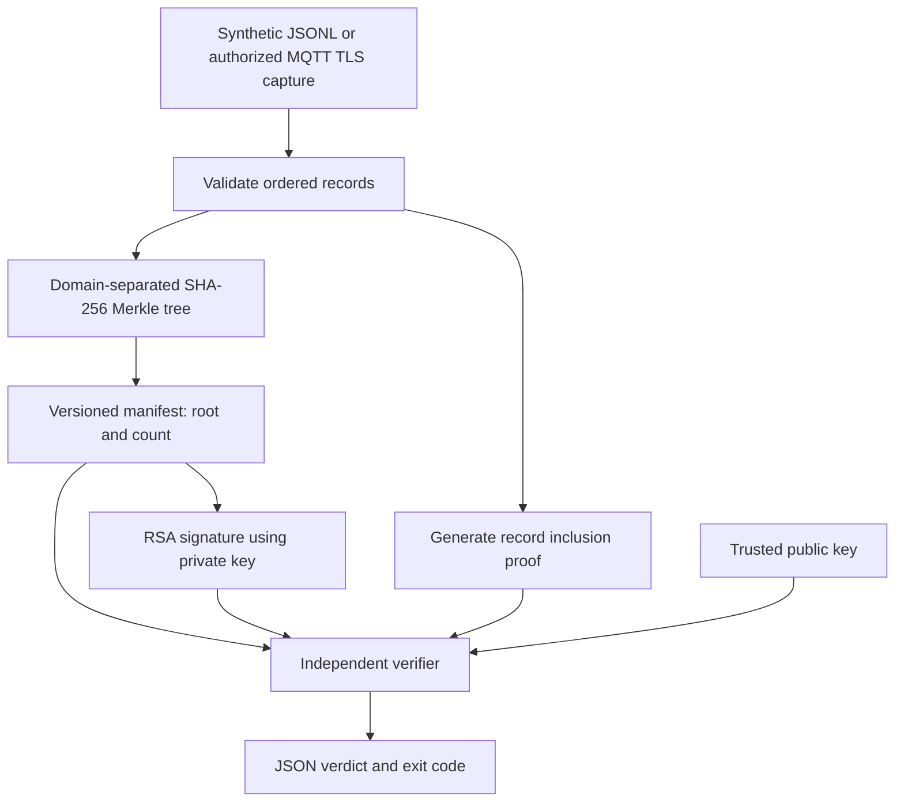

# IoT Telemetry Integrity & Tampering Detection

[](https://github.com/nvasilyev-sec/iot-telemetry-integrity/actions/workflows/tests.yml)


**Python · SHA-256 · Merkle trees · RSA digital signatures · Security automation**

A command-line security proof of concept for detecting unauthorized changes to ordered JSON Lines (JSONL) datasets and independently verifying individual records against a signed integrity manifest. Designed for synthetic IoT telemetry, audit logs, and transaction-log examples.

## Highlights

- Seal any nonempty dataset, including batches that are not powers of two.
- Authenticate the root, record count, format and algorithm version with an RSA signature.
- Generate an inclusion proof for any zero-based record index; verify it without the original dataset.
- Reject edited, reordered, removed or appended records, invalid proofs, and altered signed manifests.
- Machine-readable JSON results and nonzero exit codes for failed verification.
- Standard-library Python implementation with OpenSSL for signature operations; optional MQTT over TLS capture.

## Quick start

Requires Python 3.11+ and an `openssl` executable on macOS or Linux. No pip packages are required for the core tool. From the repository root:

```bash
python3 -m unittest discover -s tests -v
python3 scripts/demo.py
python3 -m integrity benchmark --sizes 100 1000 10000 100000
```

The demo generates disposable keys and data in a temporary directory, then cleans up. It deliberately tests rejection cases: a `PASS` line containing `FAILED` means the invalid input was correctly rejected.

## Architecture



Leaves hash a zero prefix followed by the exact record bytes. Internal nodes hash a one prefix followed by two binary child digests. Unpaired nodes are promoted unchanged. The signed record count binds the tree shape; sibling direction and the number of required siblings are derived from the requested index and authenticated count. This is a project-specific format, not an interoperability claim with other Merkle tree protocols.

## Manual CLI walkthrough

Run from the repository root using a fresh working directory (`work/` is ignored by Git). Output files are not overwritten.

```bash
mkdir work
python3 -m integrity generate work/readings.jsonl --count 17
python3 -m integrity keygen work/private.pem work/public.pem
python3 -m integrity seal work/readings.jsonl --private work/private.pem --manifest work/manifest.json --signature work/manifest.sig
python3 -m integrity verify work/readings.jsonl --manifest work/manifest.json --signature work/manifest.sig --public work/public.pem
python3 -m integrity prove work/readings.jsonl --index 12 --output work/proof.json --manifest work/manifest.json --signature work/manifest.sig --public work/public.pem
python3 -m integrity verify-proof work/proof.json --index 12 --manifest work/manifest.json --signature work/manifest.sig --public work/public.pem
```

For independent verification, distribute only the manifest, signature, proof and a public key authenticated through a trusted channel. The `verify-proof` command does not need the original dataset. Base64 encoding preserves the exact disclosed record bytes; it is not encryption. The requester must specify the expected index and check that the returned record is the one they intend to verify.

## Validation

Local Linux execution using Python 3.13.5 and OpenSSL 3.5.5: **22 unit tests and 13 end-to-end checks passed**. Tests include every position for ten batch sizes, malformed inputs, wrong keys, altered manifests and data tampering. See [recorded results](docs/VALIDATION.md).

| Scenario | Expected and observed offline verdict |
| --- | --- |
| Original dataset / valid inclusion proof | Verified |
| Edited or reordered dataset | Rejected |
| Removed or appended record | Rejected |
| Altered proof or wrong requested index | Rejected |
| Changed signed manifest or wrong public key | Rejected |

A GitHub Actions workflow is included for macOS and Linux; remote CI results have not been verified at packaging time.

## Performance

Example measurements from one local run (synthetic records, in-memory hashing only):

| Records | Tree build (ms) | Proof verification (ms) | Sibling hashes |
| ---: | ---: | ---: | ---: |
| 100 | 0.155 | 0.032 | 7 |
| 1,000 | 1.079 | 0.036 | 10 |
| 10,000 | 9.979 | 0.051 | 14 |
| 100,000 | 98.409 | 0.063 | 17 |

These are illustrative, environment-dependent single-run measurements, not production performance claims. The benchmark excludes JSON parsing, disk I/O and signature operations. Building the tree requires O(n) time and memory; a proof uses O(log n) hashes and verification time.

## Optional MQTT integration

The offline demo does not require a broker. To capture real JSONL messages, install Mosquitto clients and use your own authorized broker with a TLS listener on port 8883, trusted CA and client certificate/key. Choose a fresh exact topic with no retained messages. Example (replace placeholders, run from the project root):

```bash
mkdir -p work
bash scripts/capture_mqtt.sh localhost demo/telemetry /path/to/ca.crt /path/to/client.crt /path/to/client.key 17 > work/capture.jsonl
```

Start the subscriber before publishing JSON objects from another terminal. Confirm the subscriber exits successfully and the count is correct before sealing. QoS 1 can deliver duplicates; the capture preserves received order and does not deduplicate. Live MQTT/TLS was **not tested** in the packaged environment. No certificates or private keys are included.

## Security relevance and limitations

Signed integrity manifests and compact proofs are relevant to audit-log integrity, forensic evidence, transaction-record verification and industrial telemetry monitoring. This prototype detects changes relative to a trusted signed snapshot; it does not prove that data were truthful when captured, prevent rollback, encrypt records, or provide production key management. See [security model](docs/SECURITY.md).

## Repository layout

```text
integrity/        Merkle engine, manifest/signature operations, CLI
tests/            Automated correctness and security tests
scripts/          Offline demo and optional MQTT capture
examples/         Synthetic JSONL sample
docs/             Threat model and validation results
.github/workflows Automated CI configuration
```

## Development background

A fresh implementation inspired by graduate IoT security coursework and standard Merkle-tree concepts. The implementation, tests and documentation were generated with AI assistance for portfolio study; no instructor-provided source files are redistributed. The owner should review, run and understand the code before presenting personal contributions. This is an educational prototype, not an audited product or a representation of any employer's systems.
